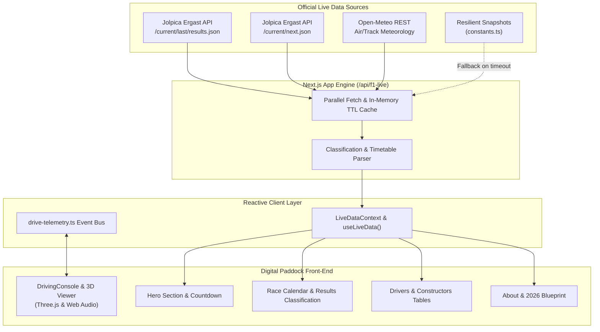

<p align="center">
  
</p>

# 🏎️ About APEXORA

> **"Built for the fans. Built for the love of racing."**  
> An open, high-performance, ad-free digital command center celebrating the speed, aerodynamics, and engineering marvel of Formula 1.

---

## 🎯 The Mission

Formula 1 is the pinnacle of global motorsport—a theater where millisecond software decisions and aerodynamic precision meet extreme human courage. Yet, mainstream digital experiences are frequently burdened by heavy paywalls, intrusive advertisements, or laggy interfaces.

**APEXORA** was conceived with a singular engineering philosophy:
1. **Zero Asset Bloat:** Deliver full, interactive 3D Formula 1 cars with authentic liveries and driver numbers using procedural Three.js geometry without downloading heavy 50MB 3D meshes.
2. **Automated Live Sync:** Seamlessly integrate official FIA Jolpica Ergast race results, DHL fastest lap records, driver/constructor standings, and Open-Meteo track temperatures with automatic local timezone session conversions.
3. **True Driver Cockpit Feel:** Offer an interactive driving console featuring realistic cockpit/T-cam onboard views, active DRS wing manipulation, and synthesized real-time V6 turbo engine audio.

---

## 🔬 2026 Technical Regulations Deep Dive

The 2026 FIA Formula 1 regulations represent the most profound aerodynamic and powertrain overhaul in modern motorsport history:

```
┌────────────────────────────────────────────────────────────────────────────────────────────────────────┐
│  2026 REGULATION BENCHMARKS                                                                            │
│  ├─ ACTIVE AERODYNAMICS : X-Mode (low drag on straights) & Z-Mode (high downforce in corners)          │
│  ├─ HYBRID POWERTRAIN   : 50% Internal Combustion (~400 kW) + 50% Electrical MGU-K (350 kW)           │
│  ├─ SUSTAINABLE FUEL    : 100% Advanced E-Fuels & Second-Gen Non-Food Biofuels                         │
│  ├─ OVERRIDE MODE (MOM) : Electric push-to-pass deployment available up to 337 km/h for chasers        │
│  └─ OVERALL CHASSIS     : 30 kg lighter minimum weight, 10 cm narrower width, active aero wings        │
└────────────────────────────────────────────────────────────────────────────────────────────────────────┘
```

### 1. Active Aerodynamics (X-Mode & Z-Mode)
To maximize energy efficiency, 2026 cars feature dual-state active aerodynamics on both the front and rear wings:
* **Z-Mode (High Downforce):** Deployed through technical braking and apex zones to anchor the chassis through high-speed sweeps.
* **X-Mode (Low Drag):** Automatically engaged down straights when active aero conditions are satisfied, reducing total vehicle drag by up to **35%** to achieve blisteringly high terminal velocities.

### 2. Tripled Electrical Boost (350 kW MGU-K)
The MGU-H (heat motor-generator unit) has been eliminated to reduce complexity and cost. In its place, the kinetic motor-generator unit (**MGU-K**) power output has jumped from $120\text{ kW}$ to **$350\text{ kW}$ (470+ horsepower)**—matching the output of the internal combustion engine.

### 3. Manual Override Mode (MOM)
Replacing traditional single-flap DRS overtaking, Manual Override Mode allows trailing cars within 1.0 second at a detection point to unleash continuous $350\text{ kW}$ battery deployment even after the leading car's power begins tapering off at $290\text{ km/h}$.

---

## 💻 System Architecture



---

## 🎧 Audio Engineering: Procedural V6 Synthesizer

Rather than looping recorded MP3 samples which suffer from audible boundary clicks and unnatural pitch stepping, **APEXORA** utilizes a custom **Web Audio API Multi-Oscillator FM Synthesizer**:
* **Fundamental Tone:** Sawtooth oscillator mapped to engine RPM ($4,000 - 15,000\text{ RPM}$).
* **Sub-Harmonic Exhaust Rumble:** Square wave oscillator with low-pass resonance filter mimicking cylinder firing order pulses.
* **Turbo Whine:** High-frequency sine wave oscillator tied directly to throttle pedal load ($0\% - 100\%$).
* **Gearshift Burble:** Micro-attenuation envelope simulating fuel cut-off ignition drops during rapid paddle shifts.

---

## 🛡️ Performance & Quality Standards

* **TypeScript:** Strict type checking with 0 `any` workarounds across telemetry payloads.
* **ESLint:** 100% clean Next.js lint status without warnings.
* **Zero Layout Shift:** Responsive monospace grid tables prevent cumulative layout shift (CLS) during live updates.
* **Accessible Semantics:** Semantic HTML5 elements (`nav`, `header`, `main`, `section`, `table`) with complete ARIA role designations.

---

## 🏁 Join the Paddock

Found a bug, want to add telemetry metrics, or suggest a new camera angle? Contributions are warmly welcomed:

```bash
git clone https://github.com/RBharath77/apexora.git
cd apexora
npm install
npm run dev
```

---

## 👨‍💻 Creator
**APEXORA** was architected and created by **[Bharath R](https://github.com/RBharath77)**.

*Formula 1, F1, and related trademarks belong to Formula One Licensing B.V. This site is created for educational and fan community enjoyment.*

