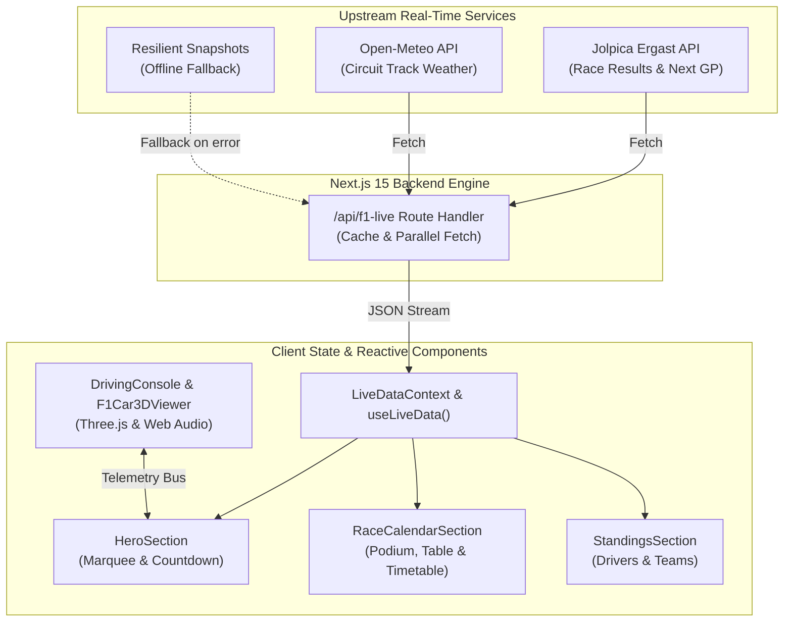

<p align="center">
  
</p>

<p align="center">
  <a href="https://git.io/typing-svg">
    
  </a>
</p>

<p align="center">
  
  
  
  
  
  
</p>

---

## ⚡ Real-Time Digital Command Overview

**F1 Fanverse Foundation** is an immersive digital command center and 3D simulation cockpit built for the **2026 Formula 1 Season**. It features automated real-time FIA race data syncing, full procedural 3D chassis inspection, an authentic driver cockpit with steering wheel telemetry HUD, interactive meteorological strategy forecasting, and interactive fan paddock experiences.

```
┌──────────────────────────────────────────────────────────────────────────────────────────────────┐
│  🏁 LIVE TELEMETRY TICKER                                                                       │
│  LAST GP WINNER : L. NORRIS (MCLAREN #1 • 1:35:23.504 • INTERLAGOS)                              │
│  NEXT GRAND PRIX: ROUND 21 // LAS VEGAS GRAND PRIX (NOV 20 - NOV 22, 2026)                       │
│  SESSIONS SYNC  : FP1 00:30 UTC • FP2 04:00 UTC • FP3 00:30 UTC • QUALI 04:00 UTC • RACE 04:00 UTC │
│  SYSTEM STATUS  : LIVE HUD ACTIVE • 60 FPS CANVAS • STEREO AUDIO SYNTHESIZER READY               │
└──────────────────────────────────────────────────────────────────────────────────────────────────┘
```

---

## 🏎️ Core Feature Highlights

### 1. 🎮 Real-Time 3D Car & Interactive Cockpit Console
* **67 Meshes & 23,044 Triangles per Car:** Pure procedural Three.js geometry with carbon chassis, front/rear multi-element wings, halo, sidepod inlets, diffuser channels, steering column, and rotating wheel assemblies.
* **11 Authentic 2026 Constructor Liveries:** Instant liveries with custom hex palettes and official driver numbers (McLaren `#1/#81`, Ferrari `#16/#44`, Red Bull `#33/#30`, Mercedes `#63/#12`, Aston Martin `#14/#18`, Alpine `#10/#43`, Williams `#23/#55`, Racing Bulls `#22/#6`, Haas `#31/#87`, Audi `#27/#5`, Cadillac `#77/#11`).
* **5 Camera Presets:**
  * 💺 **Cockpit View:** Behind the carbon-fiber steering wheel looking through the halo.
  * 📹 **T-Cam Onboard:** Authentic TV broadcast perspective above the driver's helmet.
  * 📐 **3/4 Studio View:** High-angle rotating aerodynamic showcase.
  * 🏎️ **Front Wing Apex:** Low-slung front splitter camera.
  * 🏁 **Chase Cam:** Third-person trailing chase angle.
* **Interactive Cockpit HUD:** Rev LEDs (Green $\to$ Red $\to$ Purple shift lights), digital gear display ($1-8$), speedometer ($0-360\text{ km/h}$), DRS wing actuator, ERS energy harvest bar, throttle/brake telemetry gauges, and procedural synthesized engine audio.

---

### 2. 🏆 Automated Live Race Results & Upcoming Schedule
* **Auto-Fetch Upstream Pipeline:** Server route (`/api/f1-live`) polls Jolpica Ergast endpoints in parallel:
  * `last/results.json` $\to$ Previous race classification, winner, time, and fastest lap holder.
  * `next.json` $\to$ Upcoming Grand Prix metadata and full session timestamps.
* **Dedicated Results View Toggle:**
  * 🥇 **Top 3 Podium Showcase:** Gold, Silver, and Bronze cards with constructor livery accents, total race time, starting grid delta (`▲ +gain` / `▼ loss`), and points.
  * ⚡ **DHL Fastest Lap Hero Bar:** Purple telemetry bar displaying lap number, sector lap time, and bonus point indicator.
  * 📋 **22-Car Official Classification Table:** Sticky headers, position badges, driver flags, constructor dots, starting grid, lap counts, finish times / retirement reasons, and points.
* **Upcoming Race Timetable:** Automatic conversion of official FIA session times (**FP1, FP2, FP3, Qualifying, Grand Prix**) into user's local timezone alongside UTC references.

---

### 3. 🌦️ Track Meteorology & Strategy Forecaster
* **Live Circuit Weather:** Open-Meteo integration providing air temperature, track surface temperature, rain probability percentage bar, wind speed/direction, and track grip conditions.
* **Strategy Outlook:** Suggested compound windows (Soft $\to$ Medium $\to$ Hard) based on track degradation and ambient conditions.

---

### 4. 📊 2026 Championship Standings
* **Drivers Championship Table:** 22 drivers ranked with points, wins, podiums, nationality flags, and team palettes.
* **Constructors Championship Table:** 11 teams with interactive points progress bars and constructor championship leads.
* **Grid View:** 3D tilt driver portrait cards with career statistics and telemetry spotlights.

---

### 5. 🌍 Interactive 3D World Globe & Circuit Lap Simulator
* **Spinning 3D Canvas Globe:** Pinned 2026 Formula 1 circuits with drag-to-rotate interaction.
* **Live Telemetry Lap Simulator:** Vector track outline with animated apex sectors, speed traces, and split-time tracker.

---

### 6. 🚦 Strategy Lab & FIA Start Reaction Timer
* **Pirelli Tire Degradation Matrix:** Degradation curves for C1-C5 slick compounds and wet weather tires.
* **Playable 5-Light FIA Start Simulator:** Authentic FIA random red-light blackout reaction challenge measuring driver reaction speed in milliseconds with high-score tracking.

---

## 🛠️ Architecture & Data Flow



---

## 🚀 Quick Start Guide

### Prerequisites
* **Node.js**: v18.18.0 or newer (Node.js 20+ recommended)
* **npm**: v9+

### 1. Clone & Install
```bash
git clone https://github.com/RBharath77/f1-fanverse-foundation.git
cd f1-fanverse-foundation
npm install
```

### 2. Run Local Development Server
```bash
npm run dev
```
Open **[http://localhost:3000](http://localhost:3000)** in your browser.

### 3. Production Build & Start
```bash
# Build optimized static and dynamic routes
npm run build

# Start production server
npm run start
```

### 4. Code Quality & Type Check
```bash
# TypeScript strict type check
npx tsc --noEmit --incremental false

# Next.js ESLint audit
npm run lint
```

---

## 🏎️ 2026 Team & Driver Lineup

| Constructor | Livery Color | Drivers | Power Unit |
| :--- | :---: | :--- | :--- |
| **McLaren Formula 1 Team** | `#FF8000` | #1 Lando Norris • #81 Oscar Piastri | Mercedes-AMG |
| **Scuderia Ferrari HP** | `#E80020` | #16 Charles Leclerc • #44 Lewis Hamilton | Ferrari |
| **Oracle Red Bull Racing** | `#001A30` | #33 Max Verstappen • #30 Liam Lawson | Red Bull Ford |
| **Mercedes-AMG PETRONAS** | `#00A19C` | #63 George Russell • #12 Andrea Kimi Antonelli | Mercedes-AMG |
| **Aston Martin Aramco** | `#00665E` | #14 Fernando Alonso • #18 Lance Stroll | Honda |
| **BWT Alpine F1 Team** | `#0090FF` | #10 Pierre Gasly • #43 Franco Colapinto | Mercedes-AMG |
| **Williams Racing** | `#00A0DE` | #23 Alexander Albon • #55 Carlos Sainz | Mercedes-AMG |
| **Visa Cash App RB** | `#6692FF` | #22 Yuki Tsunoda • #6 Isack Hadjar | Red Bull Ford |
| **MoneyGram Haas F1 Team** | `#E6002B` | #31 Esteban Ocon • #87 Oliver Bearman | Ferrari |
| **Audi Revolut F1 Team** | `#C00000` | #27 Nico Hülkenberg • #5 Gabriel Bortoleto | Audi |
| **Cadillac F1 Team** | `#D4AF37` | #77 Valtteri Bottas • #11 Arvid Lindblad | Ferrari |

---

## 💻 Tech Stack

* **Framework:** [Next.js 15 (App Router)](https://nextjs.org/)
* **UI Engine:** [React 19](https://react.dev/)
* **3D Graphics:** [Three.js](https://threejs.org/) & WebGL
* **Styling:** [Tailwind CSS](https://tailwindcss.com/) & Custom High-Contrast Carbon Design System
* **Data Sources:** [Jolpica Ergast F1 API](https://api.jolpi.ca/) & [Open-Meteo Weather API](https://open-meteo.com/)
* **Audio Engine:** HTML5 Web Audio API Procedural V6 Synthesizer

---

## 📄 License
This project is for educational and fan community entertainment purposes. Formula 1, F1, and related marks are trademarks of Formula One Licensing B.V.
