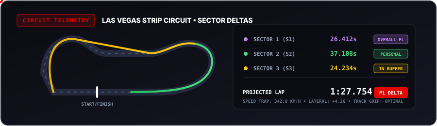
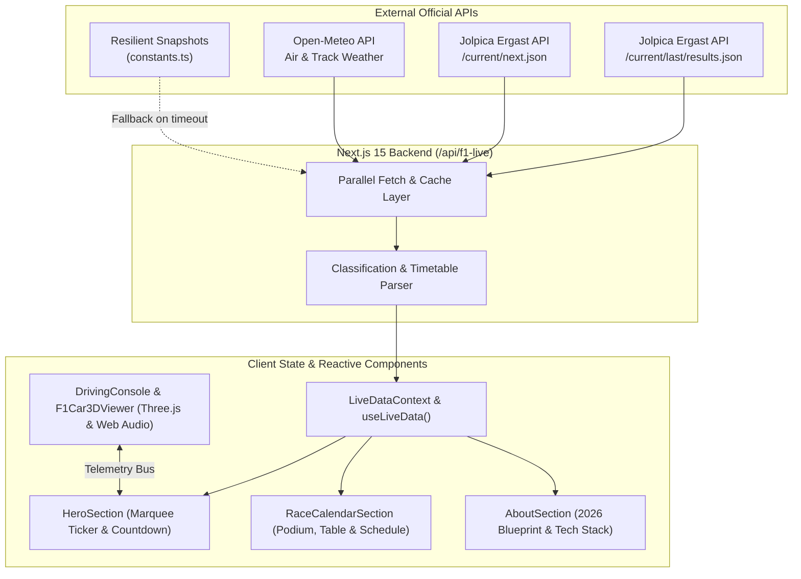

<p align="center">
  
</p>

<p align="center">
  <a href="https://git.io/typing-svg">
    
  </a>
</p>

<p align="center">
  
  
  
  
  
  
  
</p>

---

## 🏁 Live Circuit Telemetry & Sector Splits

<p align="center">
  
</p>

```
┌──────────────────────────────────────────────────────────────────────────────────────────────────┐
│  ⚡ FIA TELEMETRY MARQUEE TICKER                                                                 │
│  LAST GP WINNER : L. NORRIS (MCLAREN #1 • 1:35:23.504 • INTERLAGOS)                              │
│  NEXT GRAND PRIX: ROUND 21 // LAS VEGAS GRAND PRIX (NOV 20 - NOV 22, 2026)                       │
│  SESSIONS SYNC  : FP1 00:30 UTC • FP2 04:00 UTC • FP3 00:30 UTC • QUALI 04:00 UTC • RACE 04:00 UTC │
│  SYSTEM STATUS  : LIVE HUD ACTIVE • 60 FPS WEBGL • V6 AUDIO SYNTHESIZER READY                    │
└──────────────────────────────────────────────────────────────────────────────────────────────────┘
```

---

## 🏎️ About F1 Fanverse Foundation

**F1 Fanverse Foundation** is an open, high-performance, ad-free digital command center celebrating the speed, aerodynamics, and engineering marvel of **Formula 1's 2026 Season**.

Unlike traditional websites with heavy downloads and static pages, F1 Fanverse provides:
* **Zero Asset Bloat:** Full procedural 3D car models (67 meshes / 23,044 triangles per car) built directly in code without downloading heavy 50MB 3D files.
* **Automated Official Data Sync:** Automatic parallel background polling of official FIA Jolpica Ergast endpoints for classifications, podium results, DHL fastest laps, and upcoming session schedules.
* **True Driver Cockpit Feel:** Real-time steering wheel HUD, rev LEDs, gear indicators, active DRS flap animation, and procedural synthesized engine audio.
* **Interactive 2026 Regulations:** Active Aerodynamics simulation (Z-Mode cornering downforce vs. X-Mode straightaway drag reduction) and 350 kW hybrid power unit boosts.

👉 *For the full engineering blueprint, 2026 regulations breakdown, and design tokens, read **[ABOUT.md](ABOUT.md)**.*

---

## 🎮 Interactive Driving Cockpit & Controls

<details open>
<summary><b>🕹️ Keyboard & On-Screen Driving Controls (Click to expand)</b></summary>

| Key | Action | Telemetry Effect |
| :---: | :--- | :--- |
| <kbd>W</kbd> or <kbd>↑</kbd> | **Throttle / Accelerate** | Increases RPM up to 15,000, modulates V6 engine pitch, raises velocity to 360+ km/h |
| <kbd>S</kbd> or <kbd>↓</kbd> | **Brake** | Engages regenerative braking, glows brake discs, harvests energy into ERS battery |
| <kbd>A</kbd> or <kbd>←</kbd> | **Steer Left** | Turns front steering assembly, tilts cockpit camera, displays lateral G-forces |
| <kbd>D</kbd> or <kbd>→</kbd> | **Steer Right** | Turns front steering assembly, tilts cockpit camera, displays lateral G-forces |
| <kbd>SPACE</kbd> | **Toggle DRS** | Opens rear wing flap, reduces aerodynamic drag, displays glowing green DRS pill |
| <kbd>E</kbd> | **Deploy ERS** | Unlocks 350 kW electrical boost, pushes maximum straightaway acceleration |
| <kbd>C</kbd> | **Cycle Camera** | Cycles between Cockpit, T-Cam Onboard, 3/4 Studio, Front Wing, and Chase views |
| <kbd>R</kbd> | **Reset Car** | Centers steering, neutralizes throttle, and returns camera to origin |

</details>

---

## 🏆 Core Feature Breakdown

<details open>
<summary><b>01 — Automated Race Calendar & Previous Results Classification</b></summary>

* **Official Upstream Sync:** Queries Jolpica Ergast REST endpoints in parallel with Open-Meteo weather forecasts.
* **Previous Race Results:**
  * 🥇 **Podium Showcase:** P1 Gold, P2 Silver, P3 Bronze cards with driver numbers, team colors, total race times, starting grid positions, and points.
  * ⚡ **DHL Fastest Lap Banner:** Purple telemetry bar showing the driver, constructor, lap number, lap time, and +1 bonus point.
  * 📋 **22-Car Classification Table:** Complete race order with pos medals, driver flags, constructor dots, starting grid deltas (`▲ +gain` / `▼ loss`), and finish times / DNF statuses.
* **Upcoming Race Weekend Timetable:** Automatic conversion of FIA session times (**FP1, FP2, FP3, Qualifying, Grand Prix**) into user local timezone and UTC.

</details>

<details>
<summary><b>02 — 2026 Championship Standings & Grid</b></summary>

* **Drivers Championship Table:** Full 22-pilot ranking with real-time points progress bars, podium counters, and constructor allocations.
* **Constructors Championship Table:** 11 teams competing for the World Constructors Championship with team palette accents.
* **3D Tilt Driver Grid:** Interactive portrait cards with career records, nationality flags, and driver numbers.

</details>

<details>
<summary><b>03 — 3D Garage & Aerodynamic Inspection</b></summary>

* **67 Procedural Meshes:** Carbon chassis tub, halo, front wing mainplane, dual flaps, rear wing beam, diffuser strakes, bargeboards, sidepod radiators, and 18-inch Pirelli wheels.
* **Aerodynamic Callouts:** Interactive clickable hotspots highlighting active aero actuators, ground-effect venturi tunnels, and titanium skid blocks.
* **11 Constructor Liveries:** Switch instantly between McLaren, Ferrari, Red Bull, Mercedes, Aston Martin, Alpine, Williams, Racing Bulls, Haas, Audi, and Cadillac.

</details>

<details>
<summary><b>04 — Strategy Pit Wall & FIA Reaction Simulator</b></summary>

* **Pirelli Thermal Wear Matrix:** Live degradation curves across Soft (C5), Medium (C3), Hard (C1), and Wet compounds.
* **Playable 5-Light FIA Start Challenge:** Random red-light blackout sequence measuring reaction reflexes in milliseconds with local high-score tracking.

</details>

---

## 🛠️ System Architecture



---

## 🏎️ Official 2026 Grid & Power Units

| Constructor | Livery Color | Drivers | Power Unit | Base |
| :--- | :---: | :--- | :--- | :--- |
| **McLaren Formula 1 Team** | `#FF8000` | #1 Lando Norris • #81 Oscar Piastri | Mercedes-AMG | Woking, UK |
| **Scuderia Ferrari HP** | `#E80020` | #16 Charles Leclerc • #44 Lewis Hamilton | Ferrari | Maranello, Italy |
| **Oracle Red Bull Racing** | `#001A30` | #33 Max Verstappen • #30 Liam Lawson | Red Bull Ford | Milton Keynes, UK |
| **Mercedes-AMG PETRONAS** | `#00A19C` | #63 George Russell • #12 Andrea Kimi Antonelli | Mercedes-AMG | Brackley, UK |
| **Aston Martin Aramco** | `#00665E` | #14 Fernando Alonso • #18 Lance Stroll | Honda | Silverstone, UK |
| **BWT Alpine F1 Team** | `#0090FF` | #10 Pierre Gasly • #43 Franco Colapinto | Mercedes-AMG | Enstone, UK |
| **Williams Racing** | `#00A0DE` | #23 Alexander Albon • #55 Carlos Sainz | Mercedes-AMG | Grove, UK |
| **Visa Cash App RB** | `#6692FF` | #22 Yuki Tsunoda • #6 Isack Hadjar | Red Bull Ford | Faenza, Italy |
| **MoneyGram Haas F1 Team** | `#E6002B` | #31 Esteban Ocon • #87 Oliver Bearman | Ferrari | Kannapolis, USA |
| **Audi Revolut F1 Team** | `#C00000` | #27 Nico Hülkenberg • #5 Gabriel Bortoleto | Audi | Hinwil, Switzerland |
| **Cadillac F1 Team** | `#D4AF37` | #77 Valtteri Bottas • #11 Arvid Lindblad | Ferrari | Fishers, USA |

---

## 🚀 Quick Start Guide

### Prerequisites
* **Node.js**: v18.18.0 or newer (v20+ recommended)
* **npm**: v9+

### 1. Clone & Install
```bash
git clone https://github.com/RBharath77/f1-fanverse-foundation.git
cd f1-fanverse-foundation
npm install
```

### 2. Run Local Development Server
```bash
npm run dev
```
Open **[http://localhost:3000](http://localhost:3000)** in your browser.

### 3. Production Build & Start
```bash
# Build optimized static and dynamic routes
npm run build

# Start production server
npm run start
```

### 4. Code Quality & Type Check
```bash
# TypeScript strict check (0 errors)
npx tsc --noEmit --incremental false

# Next.js ESLint verification
npm run lint
```

---

## 💻 Tech Stack

* **Framework:** [Next.js 15 (App Router)](https://nextjs.org/)
* **UI Engine:** [React 19](https://react.dev/)
* **3D Graphics:** [Three.js](https://threejs.org/) & WebGL
* **Styling:** [Tailwind CSS](https://tailwindcss.com/) & Custom Carbon Design System
* **Data Sources:** [Jolpica Ergast F1 API](https://api.jolpi.ca/) & [Open-Meteo Weather API](https://open-meteo.com/)
* **Audio Engine:** HTML5 Web Audio API Multi-Oscillator FM Synthesizer

---

## 👨‍💻 Author & Creator

<p align="center">
  <b>Designed & Built with ❤️ by <a href="https://github.com/RBharath77">Bharath R</a></b>
</p>

<p align="center">
  <a href="https://github.com/RBharath77">
    
  </a>
</p>

---

## 📄 License & Credits
This project is an open fan project created for educational and community enjoyment. Formula 1, F1, and related marks are trademarks of Formula One Licensing B.V.

*Created by **Bharath R**.*
